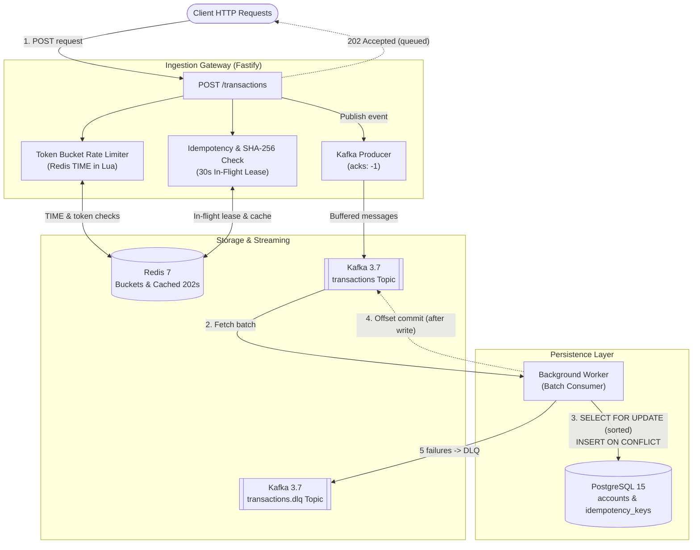

# Sluice

A small event-driven transaction ingestion gateway built in Node.js.

## Run

Start the services with Docker Compose:

```bash
docker compose up -d
```

Install dependencies and start the gateway and worker:

```bash
npm install
npm run gateway
npm run worker
```

Run tests:

```bash
npm test
```

## Architecture



## Request Flow

1. Client sends `POST /transactions` with `x-tenant-id` and `x-idempotency-key`.
2. Redis checks token bucket rate limit using Redis server `TIME` in Lua.
3. Redis claims idempotency key with a short in-flight lease and checks body SHA-256 hash.
4. Gateway publishes payload to Kafka topic `transactions` with `acks=-1`.
5. Gateway flips key TTL to 24h and replies `202 Accepted` (`status: queued`).
6. Worker consumes Kafka batches, locks accounts in Postgres, and commits offsets after write.

## Guarantees

- **Delivery**: At-least-once. Messages are not lost if workers crash or fail.
- **Deduplication**: Duplicates are prevented by a unique constraint on `(tenant_id, idempotency_key)` in Postgres (`ON CONFLICT DO NOTHING`). The financial effect is processed once. We do not claim exactly-once delivery.
- **Publish Failure & Crash Window**: If Kafka publish fails, the Redis reservation is deleted and `503` is returned so the client can retry. An in-flight lease (30s) prevents permanent lockouts if the gateway process dies before Kafka publish succeeds.
- **Broker Buffering**: When Postgres was stopped for 30 seconds during a load test, no messages were lost; the gateway kept returning `202`, and the worker resumed writing once Postgres was restarted.

## Known Limits & Honest Trade-offs

- **DLQ Ordering**: Poisoned messages that fail 5 times are sent to `transactions.dlq`. This skips the failed message and breaks FIFO per-account ordering for subsequent transactions on that account.
- **Local Single Broker**: Docker Compose runs a single broker with `replication-factor=1` and `min.insync.replicas=1`. On a single broker, `acks: -1` provides no durability benefit over `acks: 1`.
- **Redis TTL vs Database Permanent Dedupe**: If the Redis key expires (24h default), a duplicate request will re-publish to Kafka and return a new 202 ID. However, the balance is still only updated once because `idempotency_keys` in Postgres has no TTL and rejects duplicates.
- **Throughput Disparity & Lag**: Ingestion throughput (~2,565 req/s) is much faster than database write throughput (~625 tx/s). Kafka buffers the consumer lag during high-concurrency bursts until the worker drains the queue.
- **Single-Threaded Node**: The gateway runs as a single Node.js process on one thread. Ingestion rate is bounded by event-loop CPU execution.

## Measured Benchmarks

Measured on a single machine running Postgres 15, Redis 7, Kafka 3.7, Gateway, Worker, and k6.

### Machine Specs
- **CPU**: 12th Gen Intel Core i5-12450H (8 cores, 12 logical processors)
- **RAM**: 16 GB
- **OS**: Windows 11 / WSL2
- **Process Count**: 1 Node.js gateway process (single thread), 1 worker process (single thread)

### Results

| Metric | Measured Value | Notes |
|---|---|---|
| Ingestion Throughput | 2,565 req/s | HTTP POST -> Redis Lua -> Kafka publish |
| Ingestion Success Rate | 100.00% (0 errors) | 102,617 requests over 40s (100 VUs) |
| Ingestion p50 Latency | 21.91 ms | Immediate 202 acknowledgement |
| Ingestion p90 Latency | 29.30 ms | Fastify + ioredis + kafkajs |
| Ingestion p95 Latency | 32.83 ms | Gateway event loop |
| Ingestion Max Latency | 90.58 ms | Peak burst latency |
| Worker Write Throughput | ~625 tx/s | Batch consumer -> SELECT FOR UPDATE -> Postgres commit |
